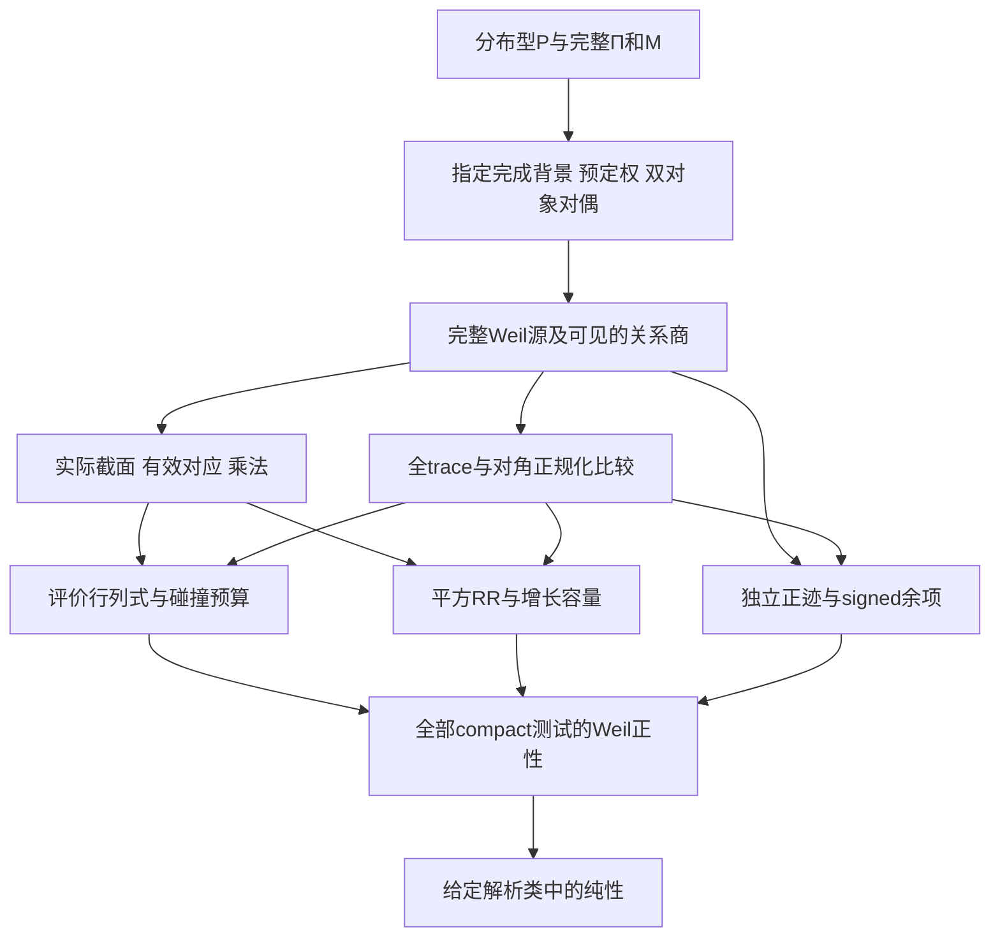

# 一般g-integer的Weil正性设施：文献综合、旧资产与后续路线图

2026-10-20，用户要求扩大检索并综合前人与本仓研究。本次是专题文献／战略审查，
不是568或新数学合同；原cadence保持2，cycle13不归零。固定G20261014／0c4f≤538。
各来源只消费注明的版本、章节与前提，没有重审全部外部证明或567篇笔记。

## 1. 目标应如何表述

建立可容纳atomic/continuous、lattice/nonlattice、双对象对偶、多权及无限容量的设施，
在其中区分“定义了ζ与对偶”“识别了完整源”“独立证明了正性”三个层级；
经典ζ须作为具体同源对象进入，不能凭形式相似列为已验证成员。

这不应表述成“每个正g-prime系统都满足RH”。562–567的连续负段及290已经反驳该断言。
适当目标是一个广的、可不定的对应理论，加上有独立来源的正性证书类。
负例应留在同一个环境中，在某项实际有效性／容量／正迹比较上失败；
不能仅以“它不几何”把反例排出，也不能从零点位置倒推设施。
RR与正极化是本研究想推广的充分机制，不声称它们是每一个类RH对象的逻辑必要条件。

## 2. 文献检索改变了哪些判断

本轮三个独立专题重开Connes/F₁、Lapidus/Beurling、Weil/Deninger的一级原件，
root另核Meyer、Burnol、arithmetic Hodge与关键旧笔记。详细版本、页码和读取范围见文末四稿。
搜索命中的二手综述、自动生成仓库和未经核验的RH证明声明，不作为数学来源。

| 来源族 | 现在可以使用的设施 | 尚不能从中取得的输入 |
|---|---|---|
| [Weil 1941原文](https://www.pnas.org/doi/pdf/10.1073/pnas.27.7.345)、1948对应理论及[2007 CCM §2.3](https://arxiv.org/pdf/math/0703392v1) | 真实有效对应、transpose/复合、canonical截面评价行列式、碰撞次数与正迹；这是一种不同于surface RR的证明组织 | 有效性和评价行列式非退化性不是正闭点计数的自动后果；无限容量须另付正规化和余项 |
| [Grothendieck 1958原文重排／RR链](https://denisevellachemla.eu/AG-Mattuck-Tate.pdf)与567核过的曲面证明 | RR二次项＋有效degree＋截面乘法＋固定容量推出index-one；567给允许增长容量的有限预算 | 一次／单周期RR不是平方二次RR；抽象h1或正性存在不能作为独立输入 |
| [Connes 1998](https://arxiv.org/pdf/math/9811068v1)、[CCM 2007](https://arxiv.org/pdf/math/0703392v1)、[Meyer v3](https://arxiv.org/pdf/math/0412277v3) | 真实算术源、局部主值、余核／核空间谱、全零点重数和分布迹；Meyer Cor4.2/Thm5.8提供明确比较基准 | 这些空间不是已证的正Hilbert零点空间；谱识别不能代正极化 |
| [Arithmetic Site 2015](https://arxiv.org/abs/1502.05580)、[Scaling Site 2016](https://arxiv.org/abs/1603.03191)、[Complex Lift 2018](https://arxiv.org/abs/1805.10501) | site及其平方、Frobenius对应、单周期theta/RR、复提升、Jessen下降和连续除子提升 | 平方虽已存在，交叉／有效性／HRR仍须建立；2018§3.4不是已证全平方RR |
| [RR for Z 2023](https://arxiv.org/abs/2306.00456)、[Jacobian 2026](https://arxiv.org/abs/2602.15941)、[Absolute Geometry 2026](https://arxiv.org/abs/2606.06604)、[Twistor 2026](https://arxiv.org/abs/2609.00299) | 实际H0/H1或模层、Picard／rank-one对象、局部曲线、无穷处实结构及动力学 | Jacobian名称不带来Rosati；局部perfectoid／Tate曲线或实结构不等于全ζ正极化；层与平方RR的比较未自动完成 |
| [CC 2020](https://arxiv.org/abs/2006.13771)、[CCM 2024 prolate](https://arxiv.org/abs/2310.18423)、[2025 spectral triples](https://arxiv.org/abs/2511.22755) | 正Sonin压缩迹及实际余项、finite-S载体／整函数实现、规定最低态前提下的自伴与det身份 | 局部窗domination≠成长全源；finite-S同构非原norm酉性；实际最低态及极限仍欠。2026 Connes综述§6.6也保留这些缺口 |
| [Hilberdink–Lapidus 2004/2006](https://arxiv.org/abs/math/0410270) | 固定核、两Mellin对象的广义FE⇔反演有限缺陷；允许把自对偶作为特例 | 未取得Lapidus–Nest更强连续dual定理全文，不能把转述/in preparation当已付；任意P的自然正dual、规范与权未由Thm3.2给出 |
| [Herichi–Lapidus](https://arxiv.org/abs/1210.0882)、[Lapidus 2015](https://arxiv.org/abs/1501.05362)、[Cobler–Lapidus 2017](https://arxiv.org/abs/1705.06222) | weighted shift的合法域／正常functional calculus、准可逆性字典、Schatten／det与重数账本 | ζ(∂c)谱为竖线值域闭包，不是零点集；右半带普通可逆性无条件失败；2017零点编码作者明说预用zeros，尚待独立几何来源 |
| [Deninger–Singhof](https://arxiv.org/abs/math/0204111)、[ALKL 2024](https://arxiv.org/abs/2402.06671) | 规定Kähler/Riemannian叶状几何可给独立Hodge正性；含preserved leaves的trace另有conormal/dual-conormal和b-trace工具 | 两类定理的载体／假设不同；preserved leaves通常破坏Riemannian条件。不能把正性定理和trace定理直接拼接成经典RH |

这些设施可组合的边界比“某某计划尚未完成”更具体：有些箭头已经有严格构造，
核心缺口在设施之间的同源比较、非退化性及正号，不能靠再列名词填补。

## 3. 一般框架至少要分开九项设施

记分布型输入为P（primitive）、Π=Σk⁻¹(T_k)*P（全部powers）、M=exp_*Π。
先规定使Mellin／Laplace对象存在的增长域；“任意分布”没有这些前提时甚至没有可讨论的ζ。
普通序列型Beurling系统只是此分布框架的一个子类。

| 设施 | 内容与已有基准 | 当前责任 |
|---|---|---|
| F0 算术源 | P/Π/M及标签、重数、Mellin增长；Lapidus框架、562真连续例 | 不混用累计N、primitive P和完整Π；不能合并同范数标签 |
| F1 自然完成与权 | 核／Γ／pole缺陷、双对象dual、预定权；564–565 | 一般P没有自动唯一完成；标准Gamma类内唯一不付membership，B(s)仍是必要反测试 |
| F2 对应与双次数 | flow、transpose、复合、两Mellin矩；567有全源不定形式模型 | F₁实际复合有例外；一般乘法数据不自动给局部加法域、Tate Fourier或product formula |
| F3 主关系与非根载体 | 局部单位、restriction/gluing、principal／metric变换、可见primitive商；405/406、518–520 | 关系理想不能冒充物理primitive；source map的domain/range必须明示 |
| F4 完整迹与对角规范 | 同一Γ finite-part/contact、全部primepowers与双pole；Connes/Burnol/Meyer、560 | 必须标ordinary/nuclear/super/b/semifinite/state；regularized trace不自动正 |
| F5 有效性与截面乘法 | 真实O(D)、非零有效degree、评价、乘法与下降 | 正计数和正的不同图交点不够；290及连续负段已有这些弱性质 |
| F6 维数／容量／RR | 二次Euler项、单尺度容量或评价det碰撞预算；567(13)–(14) | 连续维数、entropy或von Neumann dimension须另证所需单调性／过滤相容；不能替换普通dim字样了事 |
| F7 独立正极化／index | RR／碰撞预算，或几何Hodge star，或正迹减有符号误差控制 | 正号必须来自F5–F6或另一独立定理；全Weil正型／heat-CM本身是目标等价接口 |
| F8 完整覆盖与极限 | 每个compact复测试／允许growth、所有重数、分次和dual配对；必要时det识别 | 不能从fixed-S/fixed窗/有限频率推cofinal；pure除子不自动原Jordan半单 |

框架应先在宽类上保留F0–F4的可不定对象，再研究哪些独立可检验的来源能支付F5–F7。
这容纳成功与失败系统，比先把正性放进对象定义再宣布“推广RH已证”更有研究价值。
若只用Weil判据证明RH，faithful determinant并非逻辑必需；选择谱路线时才增加它的身份责任。

## 4. 从Weil证明中保留两条几何主干

### A. 有效对应与评价行列式

Weil原始曲线方法先在几何上调整对应取得有效代表；canonical截面在像点上可评价，
行列式的零／极控制碰撞，主除子的degree守恒约束复合对应与对角相交，最后得到正迹。
因此一种合法的分析推广可以研究：源定义的可乘截面空间、评价算子、非退化行列式，
以及其零／极／碰撞的独立预算。它不一定先需要完整的高维上同调理论。

但把评价行列式直接定义为目标ζ的乘积会循环；任意正Gram的det也不识别Weil源。
无限容量时要有合法Fredholm／relative版本及全部Γ对角误差，有限g证明不能直接照搬。
这是研究设计的候选，不是本轮已构造的经典设施。

### B. 平方RR与增长容量

另一条路是567的明确预算：对每个固定实compact g，从真实sections及同一cutoff j取得

\[
 |d_j+Q_W(g)|\le\eta_j,\qquad
 d_j\le R_j=\frac{2(C_j+a_j+\epsilon_j-\chi_j)+n_j|b_j|}{n_j^2},
 \quad\eta_j\to0,\quad\limsup R_j\le0.                 \tag{R}
\]

C_j是canonical容量，a_j是primitive截面的上界，ε_j是两种符号的RR误差，
b_j、χ_j是同一RR系统的线性／常数项。允许C_j发散，不允许删误差或交换极限次序。
实偶完整W的实测试可复化；别的Hermitian系统另核复结构与交叉项。

2018§3.4已经核完这项来源门：该文给复提升／下降工具，没有给经典(R)的数据。
其第2步交叉正规化、第3步平方HRR与第4步截面存在仍是计划，不以§7的Frobenius提升替代。
2023单曲线RR和2026 O(D)提供真实候选对象，却尚无到(R)的比较定理。

393进一步排除一种容易重犯的跳跃：单p过滤轮廓像的CC维数不是解析H0的普通维数；
轮廓拓扑与解析Banach商拓扑不同。要用连续维数支付(R)，须先证明乘法对过滤层的控制及
相应dimension的单调性，不能仅引用ordinary section multiplication是单射。

## 5. 叶状几何和正迹是两类具体辅助来源，不能直接合并

Deninger–Singhof给出一类独立的几何正极化来源，说明无限维本身不妨碍Hodge机制。
ALKL 2024则在有preserved leaves时构造两种reduced cohomology上的正规化迹公式，
同时组织周期轨道与无穷处奇性。这为F4提供新的、可定位的工具。
但后者一般不是前者的Riemannian对象，且使用两种carrier和b-supertrace，
不是已正的普通heat trace。应先审两者的共同适用域与pairing，不能跳过这一步。

经典源离开原点的arch部分为

\[
 -\frac{e^{-|u|/2}}{1-e^{-2|u|}}\,du.
\]

新迹公式有固定叶核|e^{κu}−1|⁻¹；形状相近只提出比较问题。单一全局character twist
可能只匹配一个半轴；两carrier的权来自真实normal/density作用，不能分别手选。
对角δ0常数也必须经实际Mellin Γ／导子规范校准，不能用可调常数修好目标。
该文introduction印刷p7的finite-part显示式，按普通积分字面在无穷端不收敛，
双侧核的扩张约定也须澄清；root与独立代理均已视觉核原PDF。应核其准确正规化定义／出处，
不能仅复制该显示式，亦不据此否定整篇trace定理。详见来源稿的限定。
本轮没有消费其为完整Γ身份，更没有消费为正性。

另一个更接近实际ζ的已付分析基准来自Connes/Sonin：

\[
 Q_L(r)=T_{F_L}(r)-\langle r,K_{F_L,I}r\rangle
 +2|\langle r,\cosh(u/2)\rangle|^2
 -2|\langle r,\sinh(u/2)\rangle|^2.                    \tag{S}
\]

560给每先fixed有限F和支撑的原norm同源身份，T≥0、K自伴紧；成长符号／费用仍欠。
这是已有独立正源与明确误差，可作为新几何映射的量纲／规范比较器，或作为独立signed路线。
不需先假设它与RR路线等价，亦不以K compact代替K小或有利符号。

## 6. Lapidus的设施放在源、域与最终识别两端

Hilberdink–Lapidus适合组织F0–F2的广义对偶、核和有限缺陷；自对偶只是特殊固定点。
本轮未取得Remark所转述Lapidus–Nest后续完整定理，记录为证据未取得，非不存在定理。

Herichi–Lapidus严格构造∂c=c+iVc与ζ(∂c)，前者的实谱动量不等于零点算子。
准可逆性给竖线无零字典，通常可逆性还需值域远离0；2015对全部0<c<1/2的可逆性等价RH，
而1/2<c<1的通常不可逆性反而无条件。自动平方ζ(∂c)*ζ(∂c)≥0不支付缺失的gap。

Cobler–Lapidus 2017提供严格的重数／Schatten／Hadamard编码；§6明确其ζ构造预用了zeros，
真正研究任务是独立几何／上同调再现同一det。故将它放在最终识别端，而非用作初始正性证书。
分形tube formula的screen/growth/分布余项账本可借作(R)/(S)的误差纪律；
partition function的正热表示仍是g-integer能级一侧，不能无桥变成primitive零点一侧。

## 7. 后续工作的顺序、准入和失败信息

下表是依赖顺序与候选准入，**不是已启动的合同队列**。成功门都要求实际对象和新比较；
没有新输入时保留准确开放责任，不以来源名或unknownH/K/CM延长研究合同。

| 顺序／工作包 | 可用输入与具体产物 | 成功意味着什么；失败怎样收口 |
|---|---|---|
| 1. 双carrier与Γ对角规范的来源比较 | ALKL 2402.06671v2 §§1.3.6、5.8、6.7及其finite-part出处；对照Burnol local Γ和563完整源。列两半轴权、transpose/density、δ0与trace类型 | 若原文允许的同一几何pairing确给规范Γ，则新增F4局部设施；只靠手乘e^(−|u|/2)、独立选两侧权或未付cδ0即不晋级。不能从局部match宣称全球RH |
| 2. 一个非退化的source→section/correspondence比较 | 从已有2026 O(D)/复提升或别的明确候选给实际map、restriction和单位变换；先做下面η0／r0双测试 | 必须既杀合法关系又保留非根方向，才进入F5；若只在辅助Fredholm参数有除子或把关系像当primitive，则停止该map。未给候选map不先开“构造整个上同调”合同 |
| 3. 只支付一种独立正性机制 | 在通过2的载体上，选评价det/collision预算或平方RR(R)，明确维数、过滤、乘法与误差 | 新输入是能计算的有效化／容量／碰撞不等式；全部条件包的存在性不算。负例须在具体条件失败；不再验证旧finite H矩阵来冒充经典进展 |
| 4. 接完整源并扩到全部compact/growth | 与Meyer/nuclear源、Burnol Γ及(S)核完整identity，保全pp/pole/contact、原norm、label重数与每个测试量词 | 新全源符号或有控逼近才支付F8。finite-S同构／有限谱／Weyl主项相同不够；允许别载体、relative或semifinite trace，但须另证所需正号 |
| 并行备选. 已有actual joint signed费用 | 560的actualreceiver、全压缩逆、真实双边界、K_L | 有新signed交叉/Γ相对费才准入；没有则停原件门，不重跑ratio或用aux全H lower替换实际误差 |

第2包有两个现成的非循环单元测试，来自405/552：

- 先固定坐标：旧源为f，物理log源为r=e^(u/2)f。I、P_an在旧f空间中。
- 对合法η0，p=Eη0属于P_an且完整旧配对为零；新principal-compatible map应消去p的类，
  若map用物理坐标，则应消去r_p=e^(u/2)p的类。
- 对固定小窗非零ψ，物理r0=(D²−1/4)ψ双pole矩为零且537给Q_W(r0)>0；
  准确地f0=e^(−u/2)r0不在I，等价于r0不在物理关系像e^(u/2)I。
  新map不能把这个非根类也杀掉。两者同时通过只认证范围／非退化性，不认证全正性。

第1包使用本轮找到的具体新来源作一次章节准入，不能变成无限检索链。
若其固定权／finite-part问题不能在原定义内闭合，就保留其一般trace设施、停止经典Γ翻译，
返回已有(S)的actual joint signed原件准入；第2–4包等待实际新map／独立估计再执行。
不继续重读已明确未付的2018§3.4，也不预设新的数学预算。

## 8. 全路线共用的验证对象

| 对象 | 必须成功／必须拒绝的责任 |
|---|---|
| 真实F5曲线及一般有限域曲线 | 交数/effective来源独立，全N_n、selfintersection、全部周期与重数；有限枚举不代尾部 |
| 连续Z_c正段、阈值与负段 | 保真正positive P/fullΠ；允许continuous设施；负段在实际正性前件失败。阈值cyclic rank1不能丢二重trace |
| 290的正整数closed-point Euler模型 | 正Euler＋FE＋formal PD/HL仍非pure；整数D=2D0−D1的D²=2是有效性／RR负测试 |
| 564的同整数gB完成化 | 算术源相同不代表完成对象相同；必须先拒绝错误B目标，不能把改变目标的反例称classic RH反例 |
| 562连续谱混合 | positive functional可用，但branch会破坏普通meromorphic整零除子；state与ordinary trace分别处理 |
| 一般数域／经典ζ | ideal标签、判别式、全部Γ_R/Γ_C、proper powers、双pole和原点contact；正性membership仍开放 |

不强迫所有类RH对象在给定原carrier上半单／正定酉化：纯零除子、Jordan、GNS商与ordinary
重数是不同层次。框架应能保留这些差别，不能为了统一表述排掉函数域／连续正例。

## 9. 因果图与本轮结算

图中的箭头不是都已证明：经典D、E/F及G的成长signed控制仍缺，J的局部／完整比较也有范围。
几何正性定理、trace定理与谱编码各有适用域，只有实际共同载体与同源map闭合后才能串接。

本轮净贡献是设施图、来源定位及可推翻的优先级，**没有新增经典独立正性或whole净界**。
实际强旧542+555→557 leading4/5、560成长K/core/coupling与Ξ保持；宏观Goal门仍open。
文献／战略审查0数学轮，不创建C031、不重置cadence、不创建未请求runtime Goal。

唯一下一动作是第1包的有限章节准入；随后按其实际结果决定停／转，不自动执行整张表。
改变优先级的证据是：一个通过关系／非根双测试的新实际map、一个同源RR/collision估计、
一个保所有Γ/pp/pole的independent positive identity，或actual K的新signed输入。

原件与消费范围：
[Connes／F₁审计](../../reviews/2026-10-20/grh-literature-roadmap/connes-f1-facility-audit.md)、
[Lapidus／Beurling审计](../../reviews/2026-10-20/grh-literature-roadmap/lapidus-beurling-facility-audit.md)、
[Weil／Deninger审计](../../reviews/2026-10-20/grh-literature-roadmap/weil-deninger-facility-audit.md)、
[旧资产与源桥核查](../../reviews/2026-10-20/grh-literature-roadmap/repository-and-source-bridge-audit.md)。
