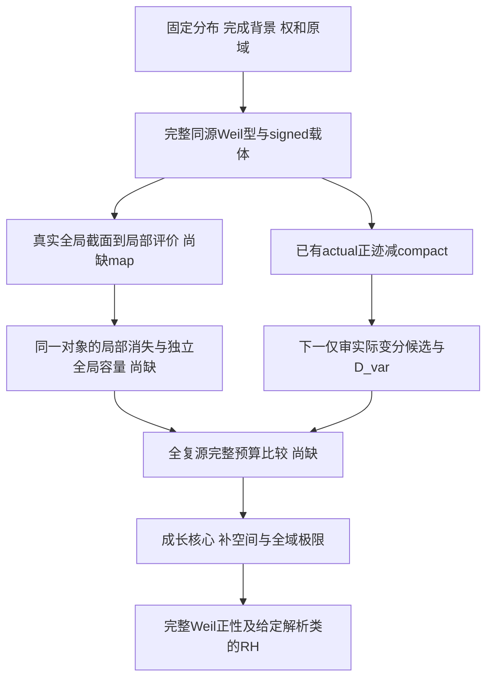

# 一般 g-integer 的 Weil 设施路线图：568–572 后修订

2026-10-20。回顾起点是[上版文献路线图](2026-10-20-generalized-weil-facilities-literature-roadmap.md)：
它写于567之后。本次新增审查对象是568–572五个完整数学迭代、Landau–Siegel专题和cycle14的战略结算。
本稿修订行动优先级，不是573，不创建C036，不执行下述下一数学门。
仍为G20261014，冻结基线0c4f3a3eb609bb1d9564138fa4a35701f05605f2／全部≤538。
本次战略审查0数学轮；原cadence保持1，正式cycle14不重置，Goal完成门仍open。

执行更新（2026-10-22）：§4的actual变分门已在[前次核查](2026-10-20-actual-variational-sonin-transport-admission.md)
执行停止；§5的2602.15941v1候选现已完成[一次实际restriction/kernel/height准入](2026-10-22-global-sections-local-evaluation-admission.md)。
真实局部前端可用，奇异层／无限支撑不保证容量；§5.2局部化定义须显式澄清。
候选仍无解析source map和平方容量，来源0停止，不再从本稿历史“下一”自动重开这两门。
当前唯一动作及重准入证据以STATE和新报告§6为准，无新数学合同。
同日按用户指令又完成[源依赖族／相对截面检验](2026-10-22-source-dependent-divisor-families-and-relative-sections.md)：
旧谱商可给实际analytic marked section，不能继续把“所有map不存在”当缺口；
仍缺的是独立算术来源、原共同费用和同对象平方容量／完整Weil身份。具体族检验后来源0收口。
其后[实际adelic限制／相对DGA门](2026-10-22-adelic-restriction-relative-square-and-quadratic-capacity.md)
已给非Ξ-base源定义复形、保degree乘法与全Pan同伦，但quasiiso为旧405商。
真实P¹_Z的n²算术容量及site平方/例外复合均存在；缺口须精确为同一实际源的primitive容量与完整预算比较。
该代数补完不自动变成新独立正性；最终阶段/审阅/root范围见STATE和本门收据，不沿旧来源标签自动续合同。

## 1. 修订后的主判断

广义对偶、完整源、评价非退化、Γ规范和局部signed费用已有真实内容；
**经典情形最缺的仍是同一全局载体上的独立容量／有效性，以及把该预算运回完整Weil型的比较。**
新研究使这个缺口更可定位，没有把它自动缩成一个有限矩阵正性问题。

因此调整为三层安排：

1. **近期唯一来源检验**：沿572留下的明确候选，检查实际Sonin变分运输及其完整平方缺陷。
   它有可核对象，值得一次便宜准入；未通过就结束这个入口，不继续优化模型高频参数。
2. **长期科学主线**：从真实全局截面／评价复形取得局部消失与全局高度的同对象预算。
   函数域的有效性／RR是来源原型，LS的同一非零minor是具体算术原型；一般g数据不自动拥有这些设施。
3. **有条件备选**：Γ相对的全源signed比较，或独立正闭形式与完整同源迹身份。
   两者需要新对象／新估计后才准入，不能只把unknown K、H或CM换名称。

这不是把目标改成Sonin模型。一次实际运输检验是最靠近已有正迹的短期入口；
若只恢复旧clipping推论，它就不能再挤占独立容量主线。

最强旧实际后果须始终扣除：542的全k／band高矩＋555的完整prime row费用，
经557的同对象混合下界和全源concentration运输，已有

\[
 n_-(Q_L)\le B_{\rm mix}(L),\qquad
 \log B_{\rm mix}(L)/e^L\longrightarrow4/5.
\]

这是issued负惯性**上预算**，不是实际负谱下界，也不是正性。
568–572没有改善它，没有解决危险核心、全源coupling或通常Ξ识别。
537/538固定窗全复源正性与底态排序仍为冻结输入，不重新计功。

## 2. 旧路线图的承诺，现已执行到哪里

| 上版任务 | 此后实际结果 | 对后续选择的改变 |
|---|---|---|
| 双carrier固定权、finite-part与Γ比较 | 569已执行：单链all-k共同character不匹配实Γ；额外normal parity能修复穿孔形状。指定Tate/Fourier/Haar规范支付完整contact；有费修复的Fourier符号会变 | 不再把“找到一个twist／contact”列为待完成主任务；算术indicial map、系数与全局比较另欠 |
| 非退化source→carrier | 568确有由完整源定义的signed商、非零评价minor及关系／非根测试；point/jet对原Dlog有真实费用，smooth probes合法 | “评价载体不存在”不再是准确缺口；该卷积商仍不是几何截面环、也不是独立全局有效性 |
| 预算片协同下降 | 569已构造实cocycle与全纯phase cocycle，连续正反例、函数域全周期关系均通过 | 不再重复构造形式determinant line来代容量；正纤维或协同下降不能筛出primitive正号 |
| 实际joint signed费用 | 570在固定S={∞,2,3}、完整G逆／全部returns上给实际mixed误差两号及同窗无限正负指数；原norm归一后误差趋零，完整Q仍正 | 统一有利号、有限秩或有限余维修复不能承担这一固定比较；保留非有限秩compact、Γ相对与源适应修复 |
| 真实receiver的双边界 | 571给同一受限像上的完整J逆恒等式、严格T=Γ(R)的单prime两号及同步m²归一平均 | 全空间算子下界不能代实际源费；模型δwin、receiver方向放大率、actual ε是不同责任 |
| 实际Euler权后的完整尾费 | 572付Euler后coherent系数、半线原域、uniform对角O(L⁴)及θ>2e同步区间内actual b平方权原dy平均O(L⁴)，包括全部相干尾和Γ端点 | 从m²归一走到实际b权是新局部费用；仍不能免费除b，不能代Sonin全逆／原源运输，更未进θ≤1核心 |
| 独立算术容量原型 | LS专题核查了非零评价minor＋有限位高阶整除＋全嵌入高度对同一个D的预算 | 这是特定实character偏置的真实原型；不支付经典ζ的全复mixed Weil预算，不恢复暂停的零区优化 |

这里没有把五篇笔记的局部成功相乘为全局定理。
特别是：568消关系／保非根已经通过，只认证其signed源map；569的协同修复已经实现，
但两者均未独立构造所需全局sections或容量。因此重复同样测试不会新增这项输入。

### 本轮最强局部资产的准确范围

572的原对象是H=L²(R,dy)，完整因果逆D_F=B_F⁻¹，
v=L_-D_F*P_Tw_R。乘实际bar b_F后先按最终F-smooth n合并，再平方：

\[
 a_{n,T}(t)=n^{-1/2}\sum_{\substack{d\mid\operatorname{rad}(F)\\d\mid n}}
 \mu(d)\mathbf1_{\{t<\log(n/d)<t+T\}},\quad t>0.
\]

固定θ>2e，选β∈(2e/θ,1)，F_L={p<e^(2L)}，R₀=exp(θe^L)，
I_L=[R₀,R₀+R₀^β]，严格T_R=Γ(R)=Re ψ(1/4+iR/2)−logπ，有

\[
 \operatorname{av}_{I_L}|b_F(R)|^2\|v_{R,T_R}\|_{dy}^2=O_\theta(L^4),
 \qquad
 \operatorname{av}_{I_L}\frac{|b_F|^2\|v\|^2}{\|w_R\|^2}
 =O_\theta(L^4e^{-L})\to0.
\]

两边界分别clean时必须同时运输K→(bar b/b)K及完整J⁻¹。
此费支付加权模型(δwin)₊，不支付负部、absolute δ、未加权v或原Weil源du/Dlog。
θ>2e是该l¹-tail／有限MV证书的充分范围，不是必要阈值或actual tail下界；
它仍在旧555已有利的高频大小层。继续优化θ、cutoff或L次幂不能自动跨入危险核心。

## 3. 九项设施的现状：局部可用不等于经典全局会员资格

一般对象先给增长域内的P、全部powers Π及M=exp_*Π，再固定完成背景、双对象对偶、预定权和源域。
没有这些前提的“最一般分布”甚至未必定义ζ。目标是广的可不定理论和独立证书类，
不是断言所有正g-prime分布都pure；连续负例必须保留并在实际证书条件处失败。

| 设施 | 568–572后可直接使用 | 经典／一般g仍须独立取得 |
|---|---|---|
| F0 算术源与标签 | P/Π/M分层、连续正反系统、完整经典prime-power源 | 数域同范数ideal标签与重数；一般碰撞须按实际值合并，不能把自由label平方当物理diagonal |
| F1 自然完成与权 | 564–565的B反测试；569固定Γ/contact校准 | 一般P的自然局部背景／类membership、分次权与dual规范；单contact唯一不排同时改核的B(s) |
| F2 对应与双次数 | 567的完整formal graph／transpose／复合／trace；局部真实étale作用 | 可有效化的global对应；一般乘法数据不自动产生局部加法域、product formula或正极化 |
| F3 主关系与非根载体 | 568 signed J_W、非退化评价、正确扩张域内关系测试 | 独立几何principal map、restriction/gluing及与同源商的比较；Q根商不是405的B商 |
| F4 全迹与对角规范 | 560实际全源正迹减compact；569局部Γ规范与协同律 | 同一载体的完整算术identity；ordinary/nuclear/super/b/relative trace须分别标明，正号不得混用 |
| F5 有效性与乘法 | 函数域真实来源；568局部jets与评价非退化原型 | 同一global section→jets的kernel、乘法、消失过滤和有效degree；非零minor本身不付这些 |
| F6 维数／容量／RR | 567允许增长容量的有限cutoff预算；LS同minor全位原型 | 独立height/collision/RR上界和全部误差；连续维数须付过滤单调性，393轮廓维数不代H⁰ |
| F7 正极化／index | 已知曲线RR/Hodge来源，560正迹，570–572局部signed比较 | 同源全复primitive正号；正J、正metric或完整Gram PSD字典都不是新的正号来源 |
| F8 全部覆盖与极限 | fixed-S/fixed窗原域身份；572指定同步区间完整尾 | actual Sonin cofinal运输、全部bulk/单边界尾、核心与补空间coupling、全部compact复源及所需谱识别 |

Connes／F₁、Weil、Lapidus与叶状几何仍各有位置，但优先级由这些未付箭头决定：

- **Weil／RR／LS**主要提供F5–F7的独立来源原型。关键是同一对象的局部限制与全局容量，而非先复制几何名称。
- **Connes／Meyer／Burnol**提供经典同源谱、迹、Γ规范和实际Sonin比较基准；不再从头“寻找一个谱空间”。
  F₁平方与局部RR不能自动代平方RR；已经审过的2018§3.4不重复当新来源。
- **Lapidus**保留F0–F2的双对象Mellin对偶、合法域及最终谱det账本。
  可逆性字典或用已知zeros编码的det不列为初始正性输入；未取得的Lapidus–Nest全文仍标未取得。
- **Deninger–Singhof与ALKL**分别提供有前提的几何正性、双carrier正规化迹工具。
  569并未构造满足两组假设的经典共同载体；停止单链直接Γ翻译不排额外parity、多leaf或新算术indicial结构。

本次只复核上版与本仓已存原件／消费范围，没有进行新一轮外部文献普查；
不把旧来源定位说成今天重新核完了全部论文证明。

所有路线的经典同源比较器保持560的原式（每次先固定有限F；接给定源窗时F须覆盖所需primes）：

\[
 2\pi\rho_F(R)=\Gamma(R)-2\sum_{p\in F,k\ge1}
 (\log p)p^{-k/2}\cos(kR\log p)+\epsilon_F(R),
\]
\[
 Q_W(r)=t_F(r)-\langle r,K_{F,I}r\rangle
 +2|\langle r,\cosh(u/2)\rangle|^2
 -2|\langle r,\sinh(u/2)\rangle|^2.
\]

ε_F∈C₀、固定源窗K自伴紧已付，但成长费与符号未付。这里没有另设矩消失条件；
Γ/contact、全部proper powers和双pole均保留。有限Euler numerator的μ不是完整−ζ′/ζ的替代品。

## 4. 路线A：一次实际Sonin变分运输准入

**状态：唯一下一来源门，尚未执行；不是新数学合同。**
准确原件为560的[完整inverse/clipping原证明](../../reviews/2026-10-14/joint-sonin-cross/full-inverse-carrier-error.md)§§3–5，
以及572[结算](2026-10-20-euler-receiver-572-settlement.md)指定的候选。

区分实际Sonin空间M上的G_M=P_M B*B P_M|M与window上的G_T。
取z_T=S_Tw_R∈P_TH、y=P_Mz_T∈M，保留actual k_R与完整G_M⁻¹。
已有正Gram变分身份是输入：

\[
 \langle k_R,G_M^{-1}k_R\rangle-
 \left(2\Re\langle k_R,y\rangle-\|By\|^2\right)
 =\|B(G_M^{-1}k_R-y)\|^2\ge0.
\]

S_T不是完整window inverse。比较它与G_T⁻¹的变分值，必须保留非负平方缺陷

\[
 D_{\rm var}(R)=\|G_T^{-1/2}(G_TS_T-I)w_R\|^2.
\]

模型δwin的signed上界或正部均值不支付D_var。
560的区间carrier clipping允许明确的有限线性组合，但绝对系数质量、谱尾与cofinal常数须全付；
“每个固定F为o(1)”不能在F_L成长时直接消费。

这次门只回答三个可判问题：

1. S_Tw_R的完整D/D*区间展开真在哪个原域内；经过P_M和B后能否消费旧clipping的准确量词？
2. 实际|b_F|²权是否出现在所需同对象比较中；若要除b或换到du/Dlog，新增费用是什么？
3. 是否得到对D_var或其实际变分组合的**新**估计，而非旧clipping直接推论加一个unknown gap？

成功准入须至少改变一项actual source/cofinal费用，或给严格更弱、实际非空的可用前件，
并保T=完整Γ(R)、全逆、两边界与全部returns。
若只回旧推论＋未知D_var，立即来源止损，不建C036，不继续扫θ/c/β、singleprime或第三prime。
即使这个门成功，也只按实际闭合范围记账；若仍限旧有利高频，就不能声称危险核心已推进。

选择它而非立即开几何合同，是因为这里已有明确候选和独立正迹，而几何global map仍未给出。
选择它而非继续572参数优化，是因为它直接检验模型到actual的缺箭头。
本稿没有执行这三个问题，也不提前宣称候选费用已付。

## 5. 路线B：同一个评价对象上的全位容量，是长期主责

**状态：候选准入规范，未启动合同。**
LS与Weil原型共同强调：非零性、局部消失、无穷位上界必须作用在同一个对象，
并保持相同截面、列／评价点、规范及尺度。不能每个局部另选一个最有利det后相加。

一个已定位的候选来源是上版Connes/F₁审计记录的2602.15941v1 Thms8.5/8.6/8.15中的真实O(D)及tensor乘法。
它只提供可核对象，不提供已知source map；本轮没有重开该外部原文，也未执行新章节门。
若原对象是模／半模，须保原范畴，不能未经证明改成复vector space或套ordinary dimension。
仅这个出处不足以启动合同，仍需新的实际restriction／源运输或独立费用证据。

下一几何候选必须先交付一个具体dossier，而不是“假设存在H⁰”的条件包：

| 必须交付 | 独立输入与最便宜反测试 | 通过后真正改变什么 |
|---|---|---|
| 一个已有定义的全局截面／模对象V_j(D)，及实际评价E_j到局部jets或有费smooth probes | 从真实O(D)/复提升或另一个明定对象出发，给restriction、kernel、乘法及度。标明所用原件命题；裸J_W像或任意有限插值不够 | 首次把全局载体而非源signed重述接到局部消失 |
| source→V_j(D)或其对应的明确map | 保旧f与物理r=e^(u/2)f坐标；消合法principal关系，保537小窗非根r₀=(D²−1/4)ψ；不得先用Q根商反定义几何 | 付同源性／非退化比较，尚不付正号 |
| 同一非零minor或determinant截面及局部order下界L_j | 真实乘法／消失过滤使局部变换保持同一对象；特征p用适当jet，不能照搬特征0普通Wronskian | 从local独立作用取得可相加的预算，不是只读出det≠0 |
| 独立全局高度／collision／RR上界A_j | A_j不按Q反定义；负连续例与函数域反模型须在这项真实前提或比较处失败 | 首次提供primitive正号的独立候选来源 |
| 同尺度完整比较 | 对每个compact复r，c_j>0，证明(A_j−L_j)/c_j→Q_W(r)，全部正规化／原域／覆盖误差趋零；或使用567同源平方RR预算，并在其已证实偶情形核复化，一般Hermitian系统另核 | 将局部—全局非负预算运到目标Weil型 |

前三项没有实际候选map就不晋级，不预建“构造全部上同调”的合同。
通过关系／非根测试只支付第二行；568已表明它不保证第四行。
569的matched cocycle/det line可作为规范工具使用，但不能再把其存在当第四行输入。
全位预算各片可以协同变换，无需强迫它们分别在Q商上下降。

平方RR是同一主责的另一实现，不要求所有一般g都必须有literal整数格或有限普通维数。
可允许增长canonical容量C_j、非局部／relative载体或有明确单调性的连续维数，
但必须独立证明乘法、过滤与维数上界，并保留567预算中的线性项、RR误差和极限顺序。
“无限容量”不是删掉上界责任的理由；“局部perfect jets”也不是全局gluing定理。

**停止条件**：只得到非零插值det、任意正metric、形式transition law、单周期RR或全部Weil Gram PSD字典，
均在入口收口。不能通过连续更换论文名延长这个没有map的缺口。
这不是证明几何路线不可能；新实际section→jets map＋独立height预算会立即改变排序。

## 6. 路线C：保留两种有条件的分析备选

| 备选 | 新准入证据 | 当前为何不主攻 |
|---|---|---|
| actual全源Γ-relative或source-adapted signed比较 | 新joint身份／更强actual clipping，保正evenpole、全部proper powers、原du/Dlog及核心／补空间交叉项；能够优于最强旧whole后果，或消除关键前件 | 570排的是固定修复类的统一取号，不排非有限秩compact；572只付模型高频，不能把未知完整比较换名重开 |
| 独立正闭形式＋完整同源热迹 | 从分布、真实局部／全局几何构造正能量，不读取未知zeros；再独立证明全time/all-period的完整源身份及trace类型／重数 | 566函数域heat lift已完成，但所用H/纯性归旧；经典普通heat身份仍欠。positive form、正jump或谱det本身不付这份身份 |

若A入口停止，先核是否确有B或C的新准入证据，再选一个具体动作；
没有就明确保留未准入，不自动排出多篇source-only审查，也不复活已停止参数路线。
外部文献只在它能提供上表某个缺失map／估计／identity时定点重开。

## 7. 每条候选共用的验证矩阵

| 系统／负对照 | 必须核到的层级 | 不能用什么替代 |
|---|---|---|
| 真有限域曲线，包括已核F₅例 | RR／有效degree／乘法／完整对应Gram的独立来源；全周期、H⁰/H¹/H²权与周期pole、全部重数 | 再算有限若干N_n或用已知纯性构造H，不算经典新容量 |
| 290／568函数域反模型 | 真实local étale/jet及formal trace仍可成立；找出global有效性、容量或primitive比较在哪一步失败 | 不以“它不是几何”直接排除，也不从零点位置倒推失败前提 |
| 连续Z_c正段、阈值和负段 | 保正P/fullΠ/M；同一个定义和实际关系作用于两段；正段通过独立证书，负段在具体正性前提失败 | local非退化、cocycle、正纤维在两段都通过，不能继续作区分证书；阈值不能丢trace二重数 |
| 564同整数gB完成化 | 比较前固定核／Γ／pole／预定权；明确错误B改变了目标完成对象 | 单contact校准或裸整数系统身份不排所有B；该反例不是canonical经典RH反例 |
| 连续谱混合 | 区分正state、ordinary/semifinite trace与通常meromorphic零除子；branch和重数各有责任 | 不能把连续谱密度直接写成通常整函数canonical product |
| 一般数域与经典ζ | 保ideal标签、判别式／导子、Γ_R/Γ_C、全部prime powers、pole/contact及原域。若走Sonin，还要真的局部Fourier/加法结构 | 经典finiteEuler、ordinary log-spacing与PNT分配函数不能从一般对偶自动继承 |

对连续g，路线A若要迁移，须另给真实有界因果可逆卷积、相应Plancherel/renewal尾费；
离散MV间距及Euler free labels不是普遍公理。函数域的periodic aliases也不能按单一实轴pole替换。
这些测试是前提鉴别与可迁移性审计，不是声称本轮新构造已在所有系统完成。

## 8. 独立输入、等价终点与验收

允许作为新输入的是：从实际sections／局部作用得到的同minor整除或collision下界、
由独立RR/height/Hodge来源给出的容量上界、同源actual signed费用、
或独立正能量与完整源之间的新比较定理。它们都须说明对象、norm、域、源与成长量词、全部误差和消费方向。

完整Weil Grams PSD、在563已证实偶且指数阶域内的完整heat-CM、要求e^(−Q)的目标曲率半正、
或者先用zeros构造自伴乘法算子，仍是等价终点／后验编码，不是初始独立证据。
一般Hermitian非偶系统的heat判据须另核，不能直接套用563的等价定理。
Weil判据可以作为最终推理工具；只有选择faithful谱实现路线时才另要求det／无额外谱／重数身份，
不能把谱det错误提升为所有RH证明的必要设施。

新的验收分三层，不能跨层计功：

1. 某个具体map、局部规范或费用被构造并通过正反测试；准确记录它的原对象与范围。
2. 它付了经典同源全源比较或成长核心中的新箭头；扣最强旧4/5及其他exact分解后仍有净后果。
3. 完整源、原域、核心与补空间、极限及所需谱识别闭合，才审长期Goal完成门。

本次没有新增上述数学输入；新增的是根据五轮结果收窄缺口、移除已执行任务并重排可推翻的优先级。
局部modelb费用瓶颈已在572改变；宏观独立容量／actual Sonin成长运输／核心仍未改变。

图中箭头是责任顺序，不是已证全部链。路线A的来源门停止不会自动证明B或C可行；
新global map＋独立容量，或能穿过实际源运输的全源signed输入，会推翻当前短期排序。

## 9. 版本、阅读范围与执行交接

本次三独占审计为[几何／预算](../../reviews/2026-10-20/roadmap-revision/geometry-and-budget-audit.md)、
[Sonin／成长](../../reviews/2026-10-20/roadmap-revision/sonin-growth-and-next-gate-audit.md)、
[设施／验证](../../reviews/2026-10-20/roadmap-revision/facilities-and-validation-audit.md)。
最终独立审阅及root消费范围另存在同目录；版本hash仅绑定范围，不认证证明。

本轮按原消费记录复核568–572及LS专题；567、563–566和外部论文主要沿上版四来源审计的精确范围继承，
不声称重证全部文献或572篇笔记。数学结论仍归各最终主稿、原证明和root收据；本路线图不放大它们的量词。

本轮不改变C035已完成状态，不新增数学迭代或正式宏观周期，不创建runtime Goal。
下一唯一数学来源准入为§4的actual变分候选，尚未执行。B/C是有条件备选，不是自动合同队列。
STATE保存当前阶段／唯一动作；本稿取代上版的执行优先级，上版保留为历史文献索引。
